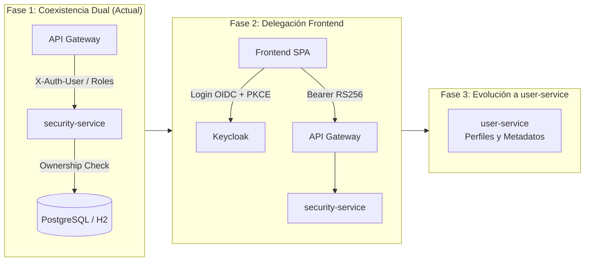

# ADR-003: Transición de la Gestión de Identidad, Autenticación y Autorización hacia Keycloak IAM

* **Estado:** Aceptado (En ejecución en Sprint 4)
* **Fecha:** 2026-11-09
* **Autores:** Luis Carlos Manuel Mamaní ([@LuisMPlus](https://github.com/LuisMPlus)), Equipo de Arquitectura DAAS (UNJu 2026)
* **Repositorios Afectados:** `logitrack-infra`, `api-gateway`, `security-service`

---

## 1. Contexto y Problemática

El microservicio `security-service` fue concebido inicialmente como un servicio monolítico de autenticación para el ecosistema LogiTrack:
- Almacenamiento local de usuarios y contraseñas hasheadas con BCrypt en su base de datos relacional.
- Generación y validación de tokens JWT propietarios utilizando criptografía simétrica HMAC-SHA256 (`HS256`).
- Compartición de la clave secreta simétrica (`security.jwt.secret-key`) entre `security-service` y `api-gateway`.

### Riesgos y Limitaciones Detectadas:
1. **Acoplamiento Criptográfico y Riesgo de Fuga:** La arquitectura simétrica exigía distribuir la misma clave secreta en múltiples servicios y perfiles de configuración (`configserver-ms`, variables de entorno), incrementando la superficie de ataque.
2. **Ausencia de Protocolos Estándar de la Industria:** No contaba con soporte nativo de **OpenID Connect (OIDC)**, flujo de autorización con **PKCE (Proof Key for Code Exchange)** requerido para aplicaciones Single Page (SPA) en React/Vue, ni revocación centralizada de sesiones.
3. **Mantenimiento Artesanal:** Funcionalidades críticas como bloqueo por intentos fallidos, reseteo de contraseñas, doble factor (MFA) y auditoría de eventos de inicio de sesión requerían desarrollo manual desde cero.

---

## 2. Decisión de Arquitectura

Se decide delegar la autenticación central, emisión de tokens OIDC y administración del ciclo de vida de identidades en un servidor de gestión de identidad y acceso de grado industrial: **Keycloak 26.x**.

### 2.1. Despliegue y Aprovisionamiento
- Se despliega Keycloak en `logitrack-infra` vía Docker Compose (`quay.io/keycloak/keycloak:26.0`).
- Se aprovisiona el Realm `lazyhawk` de manera automatizada en el arranque mediante `./keycloak/realm/lazyhawk-realm.json` con la directiva `--import-realm`.

### 2.2. Modelo Canónico de Roles RBAC
Se estandarizan cuatro roles a nivel de Realm:
- **`ADMIN`:** Control total sobre todos los recursos, repartidores, clientes, envíos y auditoría.
- **`VENDEDOR`:** Gestión del catálogo de productos y stock para el comercio (`commerce-service`).
- **`CLIENTE`:** Creación de envíos propios y visualización de su seguimiento personal.
- **`REPARTIDOR`:** Consulta de entregas asignadas y actualización de estados en ruta.

### 2.3. Criptografía Asimétrica y Validación en API Gateway
- Keycloak emite tokens firmados con algoritmo asimétrico **RS256**.
- La clave pública se expone de forma dinámica y cacheada a través del endpoint JWKS (`/protocol/openid-connect/certs`).
- El `api-gateway` valida la autenticidad, vigencia y emisor del token usando únicamente claves públicas (JWKS), eliminando por completo el conocimiento de claves privadas.
- El Gateway inyecta en las peticiones downstream las cabeceras `X-Auth-User` (identificador del usuario) y `X-Auth-Roles` (roles en formato CSV).

---

## 3. Estrategia de Transición de `security-service`

La migración hacia Keycloak se implementa de manera progresiva y sin interrupción de servicio (*zero downtime*):

### Fase 1: Coexistencia y Dualidad (Sprint 4 — Implementado)
- `security-service` mantiene sus endpoints de compatibilidad (`/api/auth/login`, `/api/auth/registro`) para clientes existentes.
- Admite autenticación directa por JWT heredado y autenticación propagada por cabeceras `X-Auth-User` y `X-Auth-Roles` inyectadas por el `api-gateway`.
- Incorpora el endpoint protegido `GET /api/auth/usuarios/{id}` con validación estricta de pertenencia de recurso (*Resource Ownership*):
  - Solicitantes con rol `ADMIN` pueden consultar cualquier usuario.
  - Solicitantes con roles `CLIENTE`, `VENDEDOR` o `REPARTIDOR` únicamente pueden consultar sus propios datos (`X-Auth-User == id || X-Auth-User == email`). Ante accesos no autorizados responde `403 Forbidden` (`Acceso denegado: No posee pertenencia sobre este recurso`).

### Fase 2: Redirección del Frontend (Siguiente Hito)
- El cliente web (`logitrack-frontend`) se suscribe directamente al endpoint de Keycloak usando el cliente público configurado con PKCE.
- `security-service` deja de emitir tokens y se enfoca en el aprovisionamiento de perfiles de negocio.

### Fase 3: Evolución hacia `user-service`
- `security-service` es renombrado formalmente a `user-service`.
- Se retira el almacenamiento de contraseñas locales (eliminando columnas de contraseñas y beans de Spring Security vinculados a hashing).
- Los perfiles de usuario conservan atributos de negocio (dirección física, preferencias, teléfono) vinculados al UUID canónico de Keycloak (`keycloakId`).

---

## 4. Consecuencias y Beneficios

### Positivas:
- **Zero Secret Sharing:** El API Gateway valida firmas sin necesitar claves privadas ni secretos simétricos compartidos.
- **Seguridad Robusta:** Protección contra vulnerabilidades de Broken Object Level Authorization (BOLA/IDOR) gracias al control de *Resource Ownership* en capa de servicio y controlador.
- **Preparado para Alta Escala:** Autenticación delegada en infraestructura especializada Keycloak con soporte nativo de alta disponibilidad y caché distribuida.
- **Inclusión del rol `VENDEDOR`:** Modelo de permisos preparado para la integración de catálogo y e-commerce.

### Negativas / Mitigaciones:
- **Mayor footprint en memoria en entorno local:** Keycloak requiere aproximadamente 500MB de RAM. Se mitiga en desarrollo ejecutando Keycloak en modo dev (`start-dev`) con base de datos H2 interna optimizada.
